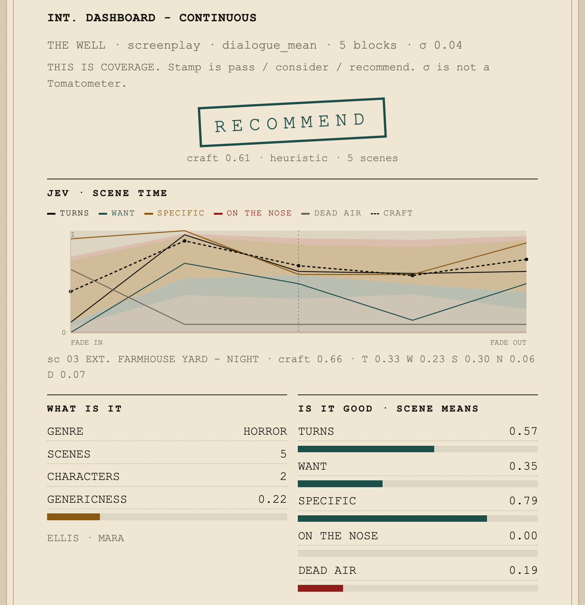
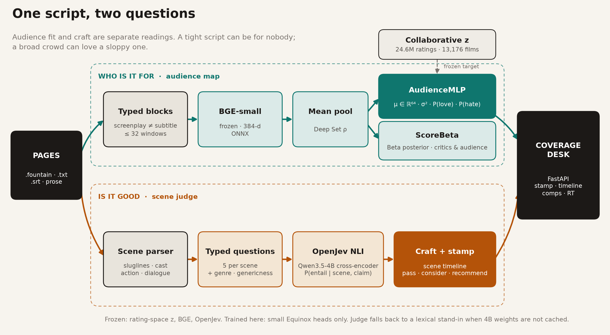
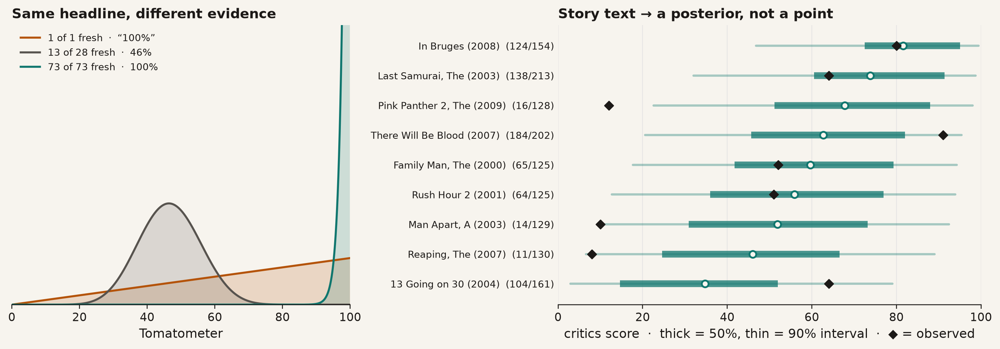
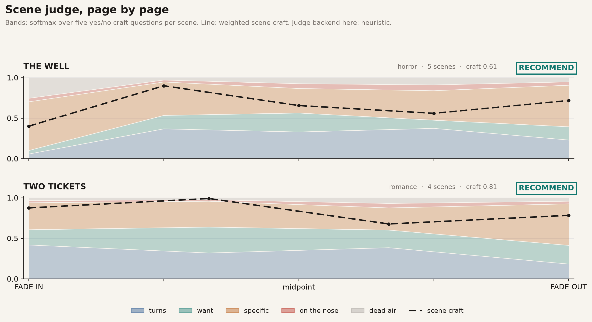

# Audience Predictor

**Cold-start audience and coverage reads for a screenplay — before anyone has seen the film.**

Hand it pages. It answers the two questions a development exec actually asks,
and keeps them separate:

- **Who is it for?** Lands the script in a 64-dimensional taste space learned
  from 24.6M MovieLens ratings, then returns comps, love/hate polarization, and
  a Rotten Tomatoes *posterior*, not a point guess.
- **Is it any good?** Reads scene by scene with an open-weights NLI judge and
  returns a craft timeline and a pass / consider / recommend stamp.

<p align="center">
  
</p>
<p align="center"><sub>The coverage desk on <i>The Well</i>, an original spec in this repo. Scene-time chart: the judge's five craft probabilities, page by page.</sub></p>

---

## Why this is hard, and what this repo does about it

Most "predict a film's success" work quietly leaks the answer. Genre tags,
critic blurbs, "Oscar-winner," "cult classic": those exist only **after** a
film is released. A model trained on them looks brilliant and is useless on
an unmade script.

This project is built around that clock. Every input is labeled by **when it
could exist**, and the shipped model only uses what is on the page.


<p align="center">
  
</p>

Read the colors, not the bar lengths. Full MovieLens genome tags reach 0.38
cosine, but most of that lift sits in production and reception tags (red,
gold) that a spec script cannot have. Teal is what you can know at script
time. That is the bar this repo reports against.

---

## System

<p align="center">
  
</p>

| Lane | Input | Model | Output |
|---|---|---|---|
| **Who is it for** | Typed text blocks (a screenplay is never merged with a subtitle file) | Frozen BGE-small embeddings → mean pool → small Equinox MLP | μ ∈ ℝ⁶⁴ in collaborative taste space, σ², P(love), P(hate), comps |
| **Reception** | Same pooled vector | `ScoreBeta` head trained on a beta-binomial likelihood of review counts | Beta posteriors for critics and audience scores |
| **Is it good** | Parsed scenes: sluglines, cast, action, dialogue | OpenJev NLI cross-encoder (Qwen3.5-4B) on typed yes/no questions | Per-scene craft probabilities, genre, genericness, stamp |

Everything big stays frozen: the rating-space embeddings, the sentence
encoder, the NLI judge. Only small heads are trained here, so the system runs
on a laptop and every learned parameter is accountable to a holdout.

---

## Results

All numbers are on a **movie-level holdout**: 20% of well-rated titles never
supervise the text model.

| Map (holdout) | When it exists | Cosine to z | Spearman, mean rating | Spearman, P(love) | Comps recall@10 |
|---|---|---:|---:|---:|---:|
| Full genome + genre + year | after audience | 0.379 | 0.91 | 0.91 | 0.053 |
| Oracle script-visible tags | script (oracle) | 0.324 | 0.89 | 0.88 | 0.033 |
| Genre + year | one-sheet | 0.185 | 0.55 | 0.56 | 0.019 |
| BGE dialogue mean-pool, n=332 | **script** | 0.150 | 0.18 | 0.20 | 0.013 |
| **BGE subtitle mean-pool, shipped, n=1,446** | **script** | **0.123** | **0.38** | **0.43** | **0.009** |
| Hashed n-grams | script | 0.033 | 0.03 | 0.25 | 0.003 |

Chance comps recall@10 is 0.003. The shipped narrative map is about **3×
chance and identical on obscure vs. famous titles**, so it isn't winning by
memorizing hits. It ranks who loves a film (ρ = 0.43) better than it matches
exact neighborhoods.

<table>
<tr>
<td width="50%"></td>
<td width="50%"></td>
</tr>
<tr>
<td><sub><b>Useful ≠ matching a released film.</b> Subtitle text already ranks which films get loved, at modest cosine.</sub></td>
<td><sub><b>The product metric.</b> Of the 10 films nearest the true fingerprint, how many show up among the predicted 10, including on the obscure half.</sub></td>
</tr>
</table>

### Reception as a posterior

A 100% Tomatometer from one review is not the same evidence as 73/73. The
reception head trains on raw `(fresh, total)` counts with a beta-binomial
likelihood and returns a full Beta distribution.

<p align="center">
  
</p>

Holdout, from story text alone (n = 1,067):

| Target | Spearman | MAE (points) | Mean 90% interval width (points) |
|---|---:|---:|---:|
| Critics (Tomatometer) | **0.57** | 20 | 70 |
| Audience score | **0.54** | 12 | 47 |
| Audience − critics gap | **0.41** | — | — |

The intervals are wide, and the model says so. *There Will Be Blood* and
*Pink Panther 2* (above) are exactly the cases where a point estimate would
mislead a greenlight meeting.

<p align="center">
  
</p>

### Scene judge

Coverage readers don't grade a script by its average vibe. They ask whether
scenes turn, whether someone wants something, and whether the writing is
specific. The judge asks those questions directly, as yes/no claims scored by
a natural-language-inference model: no text generation and no prompt
roulette.

| Head | Claim the judge tests against each scene |
|---|---|
| turns | By the end of this scene the situation has changed from the beginning. |
| want | A character is actively trying to get something or prevent something. |
| specific | The details are concrete and particular, not interchangeable stock. |
| on the nose ⚠ | The characters say exactly what they feel instead of implying it. |
| dead air ⚠ | This scene could be removed without changing what happens. |

<p align="center">
  
</p>

**Status.** The OpenJev backend
([`AlexWortega/openjev`](https://huggingface.co/AlexWortega/openjev),
Qwen3.5-4B, MIT) is wired in end to end. The figures above use the bundled
lexical stand-in, because the 4B weights are an opt-in download. That stand-in
is generous: it stamps every bundled demo *recommend*. Stamp thresholds aren't
calibrated against human coverage yet. The next milestone is scoring the judge
against Black List-style coverage labels.

---

## What didn't work, and why that matters

| Tried | Result | Lesson |
|---|---|---|
| Hashed character n-grams of scripts | 0.03 cosine, at chance | Spelling isn't taste; you need a pretrained encoder |
| Set transformer (ISAB, PMA) over scene embeddings | Lost to a plain mean | With frozen φ, attention scrambles the geometry a mean preserves |
| Full screenplay vs. dialogue only (H2) | No reliable gain | Action lines didn't add audience signal at this scale |
| Script → predicted genome tags → audience | Collapsed to the average profile, 0.02 | The right shape, but the tag predictor isn't there yet |
| SVR for Tomatometer | Clipped at fake 100s | A point score is the wrong object; replaced with a Beta posterior |
| Predicted σ as an error bar (H5) | Spearman(error, σ) ≈ 0 | σ isn't calibrated; the card says so |

Each row is logged with numbers in the [research report](reports/narrative-audience.md)
and the [lab log](https://github.com/maxmbay/audience-predictor/issues/1).

---

## Quick start

```bash
uv sync --dev --extra encoder --extra web
uv run pytest                                  # 91 tests

uv run audience-predictor serve                # coverage desk → http://127.0.0.1:8000
open "http://127.0.0.1:8000/?demo=the_well"   # deep-link a bundled spec

uv run audience-predictor predict --text-file path/to/script.fountain
```

Use the real 4B judge instead of the stand-in:

```bash
uv sync --extra openjev
OPENJEV_BACKEND=openjev OPENJEV_DOWNLOAD=1 uv run audience-predictor serve
```

The audience lane needs the sibling
[`catalog-value`](https://github.com/maxmbay/catalog-value) repo for the
rating-space embeddings (`CATALOG_VALUE_ROOT` in `.env`). Without it, the desk
still runs the scene judge and dims the audience panel.

<details>
<summary>Reproduce the research pipeline</summary>

```bash
uv run audience-predictor coverage                       # join report
uv run audience-predictor ingest-moviesum --encoder bge  # gold screenplays
uv run audience-predictor ingest-sublens  --encoder bge  # silver subtitles
uv run audience-predictor ingest-rt                      # hetrec RT counts
uv run audience-predictor train --modality subtitle_mean
uv run audience-predictor train --modality dialogue_mean
uv run audience-predictor train --modality rt_scores
uv run audience-predictor evaluate
uv run audience-predictor model-card      # docs/MODEL.md figures
uv run audience-predictor readme-figures  # figures on this page
```

</details>

---

## Data

| Source | Role | N joined to MovieLens |
|---|---|---:|
| MovieLens (via `catalog-value`) | Target: 64-d collaborative fingerprints, polarization | 13,176 films · 24.6M ratings |
| [MovieSum](https://huggingface.co/datasets/rohitsaxena/MovieSum) | Gold screenplays | 1,823 |
| SubLens-20M | Silver dialogue (subtitles) | 11,095 |
| GroupLens hetrec 2011 | Rotten Tomatoes review counts | 5,466 |

No copyrighted script text is redistributed. Git holds parsers, identifiers,
and derived vectors. The bundled demos are public-domain Shakespeare and two
original specs written for this repo.

## Stack

JAX · Equinox · Optax for models · Polars for data · ONNX BGE-small via
`fastembed` · Hugging Face Transformers for the judge · FastAPI desk ·
matplotlib figures in a shared house style.

```text
src/audience_predictor/
  data/       parsers (Fountain, MovieSum XML, SRT), joins, encoders
  models/     AudienceMLP, ScoreBeta, set encoders
  coverage/   scene schema, NLI backends, judge
  eval/       comps recall, honesty split, routing
  viz/        model-card and README figures
  web/        coverage desk
```

## Read more

- [Baseline model card](docs/MODEL.md): frozen vs. learned parts, honesty split, gates any new model must clear
- [Research report](reports/narrative-audience.md): the full ablation record, written for lay, practitioner, and technical readers
- [Roadmap](docs/ROADMAP.md)

## Guardrails

MovieLens raters aren't the moviegoing public. A missing rating isn't a
dislike. A screenplay doesn't determine the finished film. The Rotten Tomatoes
head predicts reception, which happens on the release clock, so treat it as a
translation, not a greenlight. This is coverage, not a greenlight.
