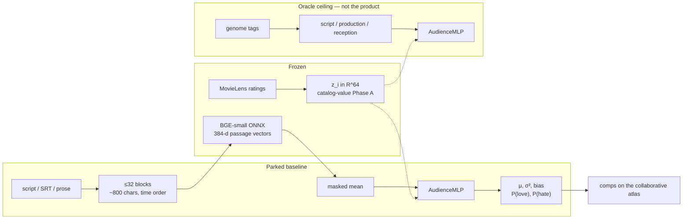
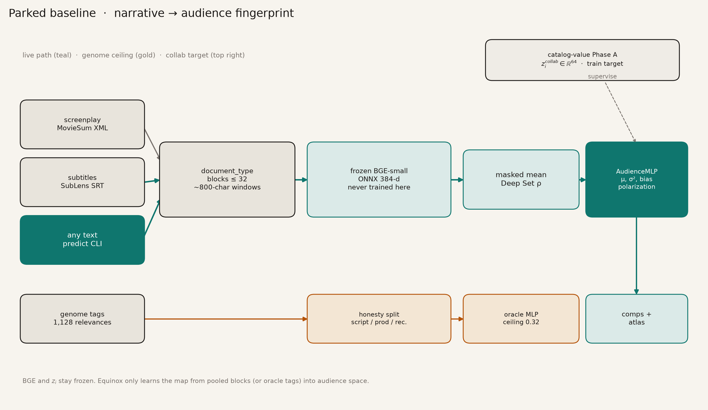
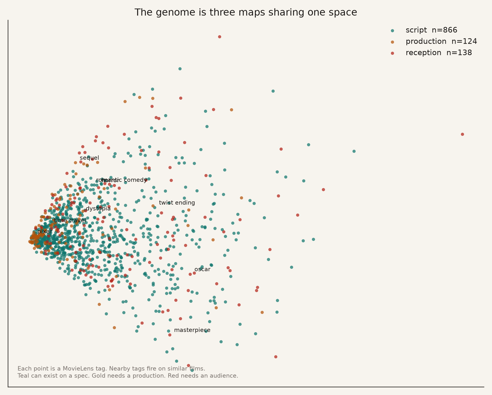
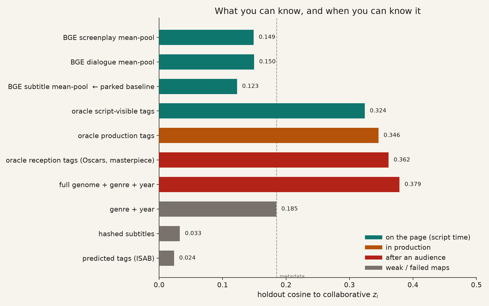
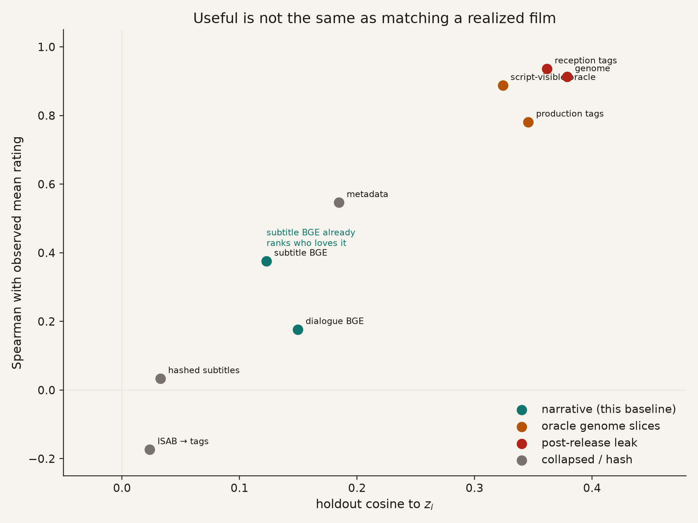
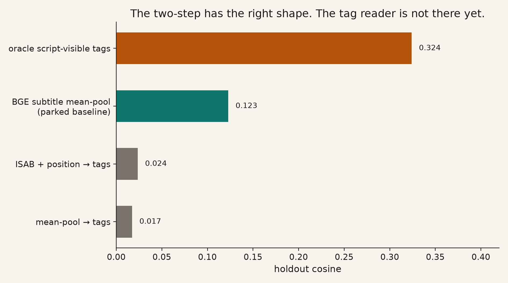
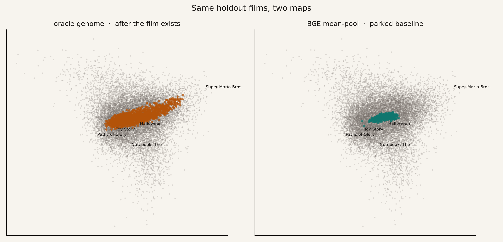
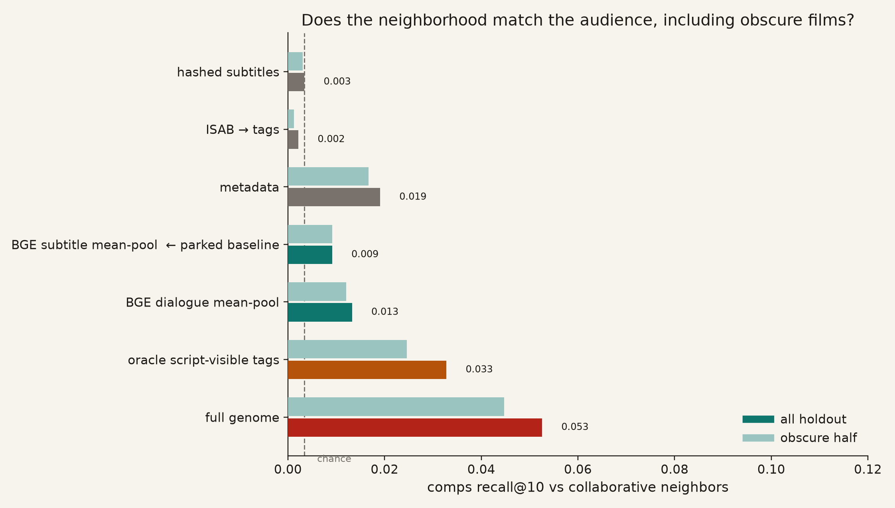
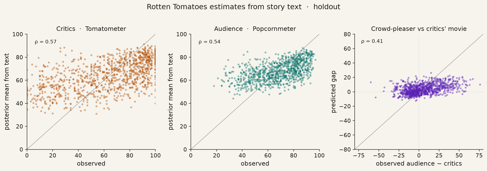

# Baseline model

Parked 13 August 2026. Later branches compare against **this** map, not against
genome. Genome is a description of a film that already exists. This model
answers a different question: given only story-shaped text, **who is this for?**

```bash
PYTHONPATH=src uv run python -m audience_predictor predict --text-file path/to/script.txt
```

---

## What is frozen, what is learned



Collaborative fingerprints `z_i` are learned from ratings alone in
`catalog-value`. This repo never updates them. Frozen BGE-small never updates
either. Equinox only learns a small map from a **pooled** story vector into that
space.



Teal is the live path. Gold is the genome ceiling — a comparison, not a ship
gate. The top-right box is the target: 13,176 titles × 64 dimensions, plus a
per-title bias and four polarization stats.

---

## Target

Each movie is a point `z_i ∈ R^64` in a multi-interest preference space.
Users in catalog-value are mixtures of eight taste tokens. We do not retrain
that space. We predict

```text
f(X) → N(μ(X), σ²(X) I),   bias(X),   aux(X)
aux = (E[r], sd(r), P(r ≥ 4), P(r ≤ 2))
```

and read the answer as **nearest neighbors of μ** among well-rated catalog
titles, plus whether the film splits a room.

Split unit is the **movie**, not the rating. Holdout titles never supervise the
text model. Eligible titles have ≥ 200 ratings. Holdout fraction 0.2, seed 0.

A subtitle is never collapsed with a screenplay (`document_type` stays distinct).
MovieSum Wikipedia summaries are post-release leak and are never used as input.

---

## Encoders

### Hash (ablation, failed)

Character 3–5 grams, blake2b into 256 buckets, L2-normalized. Deterministic,
untrained. Holdout cosine ≈ 0.03 on 11k subtitles. Spelling collisions are not
taste.

### Frozen BGE-small (parked narrative encoder)

`BAAI/bge-small-en-v1.5` via ONNX / fastembed. 384-d. Prefix `passage:`.
Cached as `data/processed/silver/sublens_blocks_bge.npz` and
`data/processed/gold/moviesum_blocks_bge.npz` — vectors only, no script text.

A movie is a set of up to 32 blocks. Screenplay blocks are scenes (dialogue and
action clipped to 800 characters, subsampled across the script). Subtitle blocks
are packed spoken windows in time order. Mean-pool is a Deep Set with frozen φ
and a learned ρ:

```text
μ = AudienceMLP( mean_j BGE(block_j) )
```

Set-transformer pooling (ISAB, PMA) over the same vectors loses to the average.

### Genome (comparison, not the product)

1,128 human tags with 0–1 relevance, plus genre and year. An MLP on the full
vector recovers holdout cosine **0.379** and Spearman **0.91** with mean rating.
That is a scouting report of a **realized** film.

Honesty split of those tags, no genre/year:

| Bucket | n tags | Holdout cosine | What it needs |
|---|---:|---:|---|
| Script-visible | 866 | 0.324 | The pages |
| Production | 124 | 0.346 | Studio, franchise, format |
| Reception | 138 | 0.362 | An audience, awards, “masterpiece” |
| Full genome + side | 1,128+ | 0.379 | All of the above |

Reception almost matches the full genome. That is the leak. Script-visible
oracle tags still recover **0.32** — leftover headroom for a better reader,
not a requirement for shipping.



Each point is a genome tag, placed by PCA over which films it fires on. Teal
can exist on a spec. Gold needs a production. Red needs an audience.

---

## Parked inference path

1. Classify the document (screenplay / subtitle / synopsis / unknown).
2. Pack into ≤32 blocks.
3. Embed with frozen BGE.
4. Masked mean.
5. Route the head: screenplay / shooting_script → `dialogue_mean` (MovieSum
   gold); everything else → `subtitle_mean` (SubLens silver).
6. Print a guess card: comps, polarization, σ. σ is not calibrated.

Heads: two GELU / LayerNorm layers, width 256, then μ ∈ R^64, log σ², bias,
and four aux stats. Loss is MSE on z, Gaussian NLL, bias MSE, aux MSE.

`--json` dumps the same payload for machines. Predicted genome tags are not
on this path.

This is weaker than genome. It is the only narrative map that currently
produces a neighborhood from text that could exist **before ratings**.

---

## Findings



**When** you get the signal matters more than the cosine. Full genome is a
post-release object. The parked baseline lives on the teal row: story text
only.



Cosine to `z_i` is not the product. Subtitle BGE sits at 0.123 cosine and
**0.38 Spearman** with observed mean rating. Dialogue BGE is a bit higher
cosine (0.150) and worse at ranking love. Genome is in the top-right because
it has seen the realized film. A draft does not have to land there to be
useful.



Script → independent tag relevances (not a simplex) → frozen genome MLP is
the right *shape*. ISAB+position and mean-pool tag heads both predicted the
average genome profile (per-tag Pearson ≈ 0.03). Downstream cosine collapsed
to ~0.02. Do not route `predict` through tag models until they beat this
baseline on **comps and polarization**, not until they beat genome.



Same holdout films. Left: oracle genome. Right: parked BGE mean-pool. The
right map is coarser. It is also the one you can run on an unmade script.

Holdout numbers for the parked comparison set:

| Map | Cosine | Spearman mean | P(love) | Comps R@10 | Obscure R@10 | n |
|---|---:|---:|---:|---:|---:|---:|
| Full genome | 0.379 | 0.91 | 0.91 | 0.053 | 0.045 | 1,596 |
| Oracle script-visible tags | 0.324 | 0.89 | 0.88 | 0.033 | 0.025 | 1,596 |
| Metadata (genre + year) | 0.185 | 0.55 | 0.56 | 0.019 | 0.017 | 1,596 |
| BGE dialogue mean-pool | 0.150 | 0.18 | 0.20 | 0.013 | 0.012 | 332 |
| **BGE subtitle mean-pool (baseline)** | **0.123** | **0.38** | **0.43** | **0.009** | **0.009** | **1,446** |
| Hashed subtitles | 0.033 | 0.03 | 0.25 | 0.003 | 0.003 | 1,446 |
| ISAB → tags → z | 0.024 | −0.17 | −0.01 | 0.002 | 0.001 | 1,446 |

Chance comps R@10 is **0.003** (10 / ~2,955 popular titles). Genome itself only
recovers about half of one collaborative neighbor in the top 10 — cosine 0.38
is not a tight neighborhood. Hashed maps sit on chance. The parked baseline
is ~3× chance, and **identical on obscure vs famous**, so it is not a
popularity leak.

H2 (full screenplay beats dialogue) is not supported at working recovery.
Mean-pool beats ISAB/PMA. Polarization can be useful when cosine is modest.
σ does not yet track error (H5).

---

## Product metric: does the neighborhood match?



Cosine asks “how close is μ to z_i?” The product asks “who does this sit
next to?” Comps recall@10 is that question: of the 10 popular films nearest
the true fingerprint, how many are among the 10 nearest the predicted μ.

Genre + year still beats any narrative map on this metric (0.019 vs 0.009).
That is the honest bar for an unmade original that does not yet have a
locked genre. Franchise-shaped scripts (Star Wars, Pirates, LOTR) already
look useful to a reader even when recall is low: narrative finds sequels
and siblings, while collaborative neighbors of a mega-hit are prestige
taste-mates. Cards: [reports/probes.md](../reports/probes.md).

Matched gold holdout (same 332 MovieSum titles):

| Head | Cosine | Comps R@10 | Spearman P(love) |
|---|---:|---:|---:|
| `dialogue_mean` (screenplay route) | 0.150 | **0.013** | 0.20 |
| `subtitle_mean` (baseline) | 0.084 | 0.008 | **0.30** |
| metadata | 0.184 | 0.013 | 0.54 |
| genome | 0.436 | 0.057 | 0.88 |

Routing a screenplay to `dialogue_mean` **wins comps**, **loses
polarization**, on the titles that head was trained for. `predict` now
routes that way. Subtitle / SRT / unknown stay on `subtitle_mean`.

---

## How later branches should compare

Do not treat “beat 0.379 genome cosine” as success. Compare against **this
baseline** on the same holdout movies:

| Gate | Parked number | Notes |
|---|---|---|
| Comps recall@10 | **0.009** (subtitle, n=1,446) | Must beat this on SubLens holdout. Chance is 0.003. |
| Obscure recall@10 | **0.009** | Equal to famous — do not win by leaking hits. |
| Spearman mean rating | **0.38** | |
| Spearman P(love) / P(hate) | **0.43 / 0.35** | |
| Screenplay comps (gold n=332) | **0.013** (`dialogue_mean`) | Beat this to replace the screenplay head. |
| Qualitative | [probes.md](../reports/probes.md) | A reader marks useful / not. |

Parked research (fewer tropes, tag-name queries, contrastive φ, LLM-as-tagger)
only ships if it clears those gates. Genome cosine is a comparison, not a
ship criterion.

```bash
PYTHONPATH=src uv run python -m audience_predictor evaluate
PYTHONPATH=src uv run python -m audience_predictor probes
PYTHONPATH=src uv run python -m audience_predictor predict --text-file path/to/script.txt
```

## Rotten Tomatoes estimates

A second head, `rt_scores`, maps the same pooled BGE vector to an estimated
Tomatometer and Audience Score. Labels are the GroupLens hetrec 2011 snapshot
joined on IMDb id — scores of films that already existed, through about 2011.
That is the reception clock. We still print them because people already speak
that language.

```bash
PYTHONPATH=src uv run python -m audience_predictor ingest-rt
PYTHONPATH=src uv run python -m audience_predictor train --modality rt_scores
```



Holdout on SubLens titles that have a hetrec score:

| Head | Spearman of E[π] | MAE | mean 90% width | n |
|---|---:|---:|---:|---:|
| Critics (Tomatometer) | **0.57** | 0.20 | 0.70 | 1,067 |
| Audience (Popcornmeter) | **0.54** | 0.12 | 0.47 | 927 |
| Gap (audience − critics) | **0.41** | — | — | 927 |

The head predicts a **Beta posterior** \(p(\pi \mid \text{text}) = \mathrm{Beta}(\alpha(x), \beta(x))\),
not a point score. Training uses the beta-binomial likelihood of the observed
counts \((k, n)\) — fresh of all-critics, liked of audience. A 100% Tomatometer
with one review is \((k=1, n=1)\), which barely moves the posterior; 73/73 does.
The guess card prints the posterior mean and a 90% equal-tailed interval.

On this holdout the posterior mean never reaches 0.95 (max 0.91). The 81
observed 100%s — many of them thin-count — map to a median mean of 0.79.
Typical concentration κ is about 3 for critics and 9 for audience, so the
intervals are wide: text ranks films but does not pin a Tomatometer. That is
the honest answer; a point 100 was an artifact of clipping an unbounded SVR.

The mapping is a small MLP (same 384-d pooled BGE) to \((\mathrm{logit}\,\mu, \log\kappa)\)
per column, with \(\alpha = \mu\kappa\), \(\beta = (1-\mu)\kappa\), \(\kappa \ge 2\).
AdamW, early stopping on held-out NLL (best epoch 131 of 1,500). An RBF SVR
still wins on Spearman of a *point* score (0.59 / 0.56); a point score is the
wrong object for this target.

Two label notes, both load-bearing. hetrec records an unrated film as score
`0` with zero reviews rather than `\N`; those stay missing. Counts still differ
per column because a title can carry a critic score and no audience score.
An RBF SVR beat this MLP on Spearman of *point* scores, but a point score is
the wrong object for this target.

The guess card then adds critics / audience / the gap (crowd-pleaser vs
critics' movie), each with a 90% interval. Comps stay the product. Do not
optimize this head at the expense of neighborhood recall. These scores are a
**reception estimate**, same clock as awards tags — useful language, not a
greenlight.

Lab log: [issue #1](https://github.com/maxmbay/audience-predictor/issues/1).

