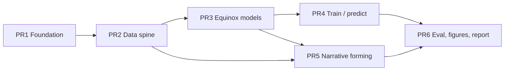

# PR Roadmap: Narrative → Audience (JAX / Equinox)

This repository predicts a film's **Audience Fingerprint** — the distribution of viewers who respond positively to it in a learned latent preference space — from narrative content, *before any ratings are observed*.

It does **not** predict box office. Collaborative audience space and catalog-value machinery live in the sibling `catalog-value` repo. This repo learns `Narrative → z_i` in JAX/Equinox and plugs into that space.

```text
catalog-value                         audience-predictor (this repo)
────────────────────────────────────────────────────────────────────
Ratings → z_u, z_i^{collab}           KEEP as frozen targets
Genome MLP → z_content (PyTorch)      REPLACE with Equinox encoders
shrink_posterior / MCV / PACV         KEEP as downstream consumers
```

Stack: Python 3.12, JAX, Equinox, Optax, Polars, pytest, ruff.

---

## Guiding constraints

- **Cold-start is movie-level.** Held-out titles never leak into training targets as if we had seen their ratings for the text model.
- **A subtitle is not a screenplay.** `document_type` is never collapsed.
- **Do not redistribute copyrighted scripts.** Publish parsers, identifiers, derived features, models, and analysis.
- **Fork, don't extend `catalog-value` in place.** Read its parquet/npz artifacts; reimplement neural code in Equinox.
- **Precompute narrative features.** Train hierarchical aggregators on cached block embeddings, not raw tokens every epoch.

---

## PR map



Stacked on purpose: each PR is reviewable, tests go green before the next, and the report is the last merge.

---

## PR 1 — Foundation

**Scope.** Installable package, configs, paths, CLI stub, test harness, this roadmap.

**Deliverables**

- `pyproject.toml`: jax, jaxlib, equinox, optax, polars, matplotlib, scipy, sklearn
- `src/audience_predictor/{paths,config,cli}.py`
- `configs/default.yaml` (`embedding_dim: 64` to match catalog-value)
- pytest + ruff; `python -m audience_predictor --help`

**Tests.** Config loads; paths resolve; CLI help exits 0.

**Out of scope.** Data, models, training.

---

## PR 2 — Data spine and coverage

**Scope.** Bridge to `catalog-value`, join keys, secondary targets, movie-level splits, honest coverage report.

**Deliverables**

- `CATALOG_VALUE_ROOT` (env / sibling default)
- Load `core/movies.parquet`, `titles.npz`, genome, ratings, tags
- Polarization targets from ratings: `E[r]`, `Var(r)`, `P(r≥4)`, `P(r≤2)`
- Movie-level train/holdout split (optional temporal cut)
- Provenance schema for narrative documents
- Coverage report: MovieLens overlap, rating-depth histogram, `N_screenplay = 0` until gold corpus exists

**Tests.** Split has no index overlap; target shapes align to `movie_row`; coverage JSON schema.

**Most important number.** `N_screenplay ∩ MovieLens`. Until gold scripts arrive, silver modalities (genome, tags, synopses) carry the supervised experiments.

---

## PR 3 — Equinox models

**Scope.** The neural objects, fully unit-tested on synthetic tensors. No data lake required.

**Deliverables**

1. **`AudienceMLP`** — vector → `(μ ∈ R^64, log σ², bias, aux polarization)`. Genome/metadata baseline; the thing the screenplay encoder must beat.
2. **`NarrativeSetEncoder`** — Set-Transformer-lite in Equinox:
   - hashed (or pretrained) block embeddings
   - induced self-attention (ISAB)
   - pooling by multihead attention (PMA) with a learned movie query
   - heteroscedastic Gaussian head
3. **Residual streams** — dialogue-only vs action/structure vs full; `z_full = z_dialogue + Δ`
4. **Gaussian shrinkage posterior** (numpy/JAX, same contract as catalog-value)

**Tests.** Shape contracts; JIT + `vmap`; padding mask ignores dummy blocks; residual identity when action is empty; NLL finite.

---

## PR 4 — Training and prediction

**Scope.** Optax loop, checkpoints, movie-level eval, CLI.

```text
audience-predictor train --modality genome|metadata|tags|hierarchical
audience-predictor predict --checkpoint ... --out ...
audience-predictor evaluate
```

**Deliverables**

- `eqx.filter_value_and_grad` + AdamW
- Losses: MSE on `z_i^{collab}`, Gaussian NLL, optional aux on polarization
- `eqx.tree_serialise_leaves` checkpoints
- Metrics: cosine, RMSE, NLL, CRPS, Spearman(predicted vs observed aux)
- First real run: **genome MLP**, reproducing catalog-value Phase B in JAX (bar to beat)

**Tests.** One-step loss decreases on a toy batch; checkpoint round-trip; evaluate refuses overlapping movie rows.

---

## PR 5 — Narrative forming

**Scope.** How a story becomes a set of blocks the Equinox encoder can consume.

**Pipeline**

```text
tokens → dialogue/action blocks → scenes → (optional acts) → movie
```

**Deliverables**

- Screenplay parser: scene headings, INT/EXT, characters, dialogue, action, parentheticals
- Document-type classifier: `screenplay | shooting_script | transcript | subtitle | synopsis | unknown`
- Character-graph statistics (co-scene edges, entropy, density)
- Stable feature hashing (blake2b n-grams) so we stay in JAX without a PyTorch LM
- Silver block builders:
  - MovieLens user tags as folksonomy blocks
  - TMDB overviews as sentence blocks (`document_type=synopsis`)
  - Genome tag names weighted by relevance (content baseline as text)
- Ablation feature sets: metadata / dialogue-proxy / structure / full / +metadata
- Parser fixtures only (original text). No scraped copyrighted scripts in git.

**Tests.** Parser on fixtures; classifier distinguishes screenplay vs SRT; hasher is deterministic; block tensors respect `max_blocks`.

---

## PR 6 — Evaluation, visualizations, report

**Scope.** Cold-start evaluation, figures, and a three-register technical report.

**Figures**

1. Audience map — collaborative atlas vs predicted location + uncertainty
2. Probe films — predicted comps vs collaborative comps
3. Ablation bars — metadata / genome / tags / hierarchical
4. Residual signal — where full narrative beats dialogue-proxy
5. Breadth / polarization — predicted vs observed
6. Data-scaling curve — holdout cosine vs train size
7. Uncertainty calibration — error vs predicted σ (H5)
8. Coverage funnel — scripts → IMDb → MovieLens → rating depth

**Report registers** (see `reports/narrative-audience.md`)

- **Low:** what the system is for, in plain language
- **Medium:** how to run it, what each modality means, what the plots show
- **High:** likelihood, set attention, cold-start protocol, hypotheses H1–H6, guardrails

---

## Testing strategy (every PR)

| Layer | What | Where |
|-------|------|--------|
| Unit | parser, hasher, shapes, masks, losses, splits | `tests/` , no MovieLens required |
| Contract | Equinox modules JIT/`vmap`; checkpoint round-trip | `tests/test_mlp.py`, `tests/test_hierarchical.py` |
| Integration | skip-if-no-bridge; train one tiny epoch against real `titles.npz` | `tests/test_bridge.py` |
| Eval leak | holdout movie rows disjoint from train | `tests/test_splits.py` |

Synthetic tensors are the default. The 13k-title run is a CLI experiment, not a unit test.

---

## Training / prediction protocol

1. Freeze `z_i^{collab}` from `catalog-value/outputs/phase_a/titles.npz`.
2. Split **movies**, not ratings.
3. Fit `f_θ(X_i) → (μ, σ²)` on train movies only.
4. Predict holdout movies from narrative/content features alone.
5. Score recovery of `z_i^{collab}` and polarization aux.
6. Optionally shrink toward content prior with the existing posterior formula so MCV stays plug-and-play.

Primary metric: **holdout cosine** to collaborative embeddings. Secondary: NLL/CRPS (calibration), polarization Spearman, qualitative comps.

---

## What this milestone will and will not contain

**Will**

- A working Equinox pipeline from catalog-value artifacts to cold-start audience predictions
- Genome, metadata, tags, and hierarchical-hash ablations
- Screenplay parser + provenance ready for a gold corpus
- A report with figures at three technical depths

**Will not (yet)**

- A several-thousand-film gold screenplay dump (legal/provenance work; ingestion scripts only)
- Training a foundation LM from scratch
- Claiming the screenplay *causes* audience outcome

Until gold scripts land, silver text (tags, synopses) plus genome/metadata answer: *does narrative-shaped information recover audience space beyond popularity and genre?* That is H1. H2 (screenplay > dialogue) stays structurally ready and empirically pending.

---

## Later branches (after PR 6)

**Gold screenplays (MovieSum first).** `ingest-moviesum` parses the Hugging Face XML dump, joins `tt` IMDb ids onto the catalog-value spine, and writes provenance + hashed blocks. No script text in git. Train `screenplay` vs `dialogue` on the overlap only.

**Silver subtitles.** SubtitleCF / SubLens-20M (~19k files named by imdbID), then OpenSubtitles via OPUS for pretraining scale.

**More gold identifiers.** Script Savant, IMSDb, SimplyScripts, Daily Script, Script Slug — collect identifiers and join; do not scrape as the first ingest.

**Joins.** IMDb non-commercial datasets and TMDB API for entity resolution and metadata. MovieLens 25M is already in catalog-value; 32M is a later spine bump.
