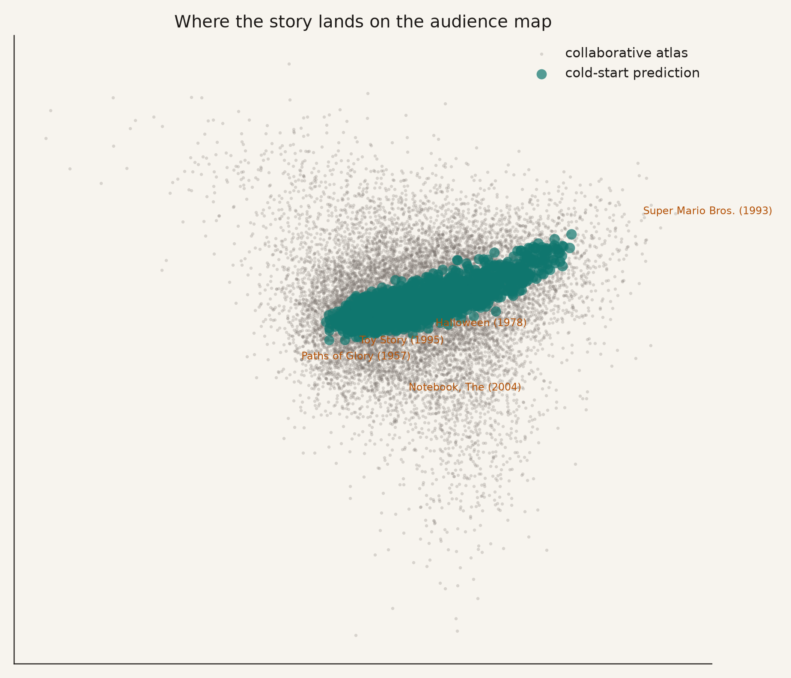
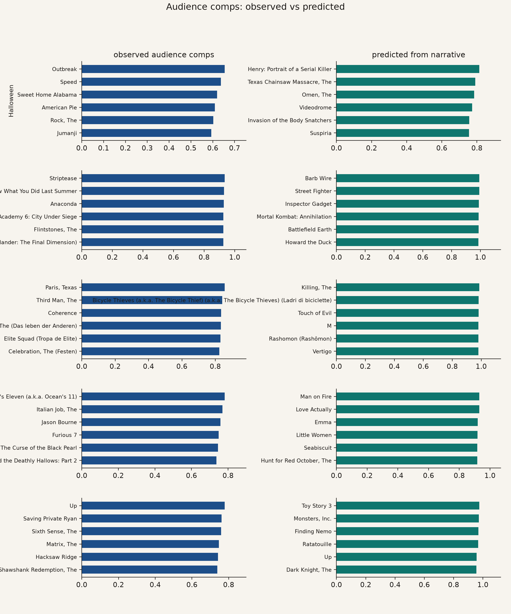
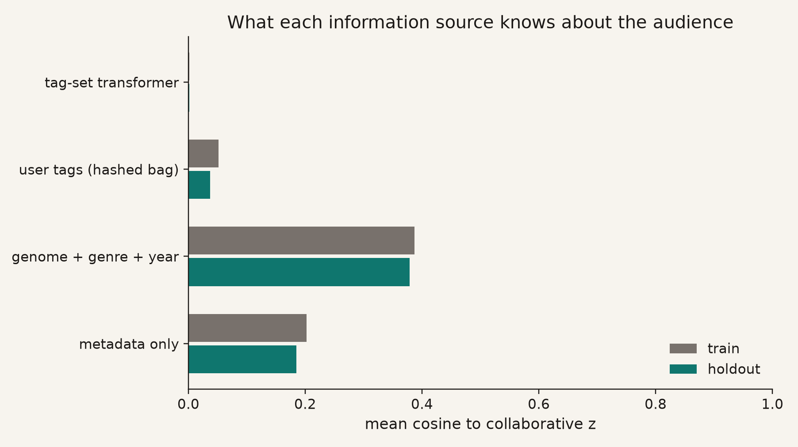
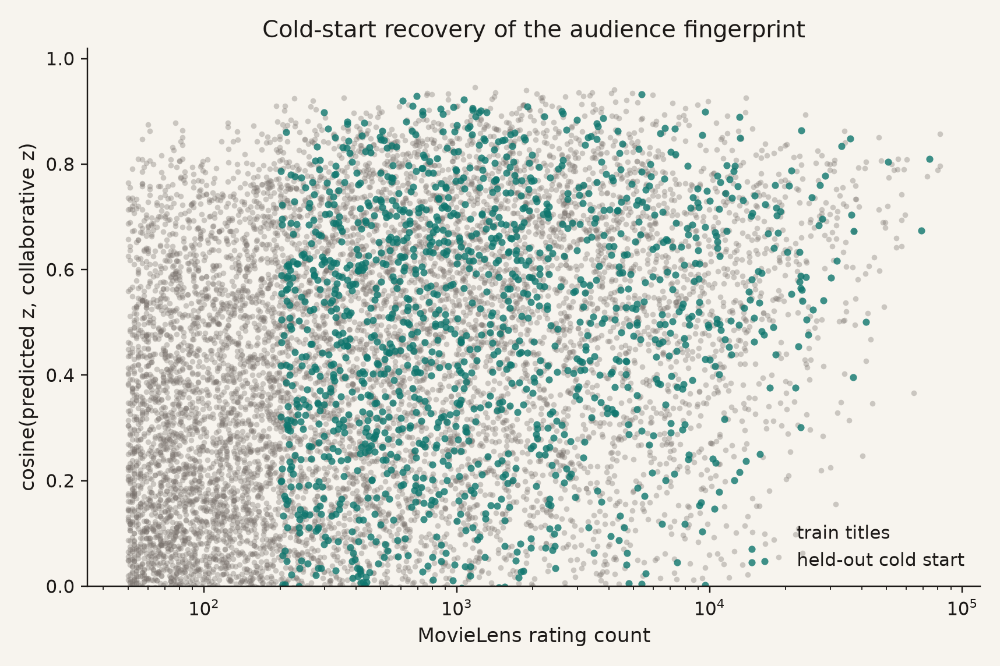
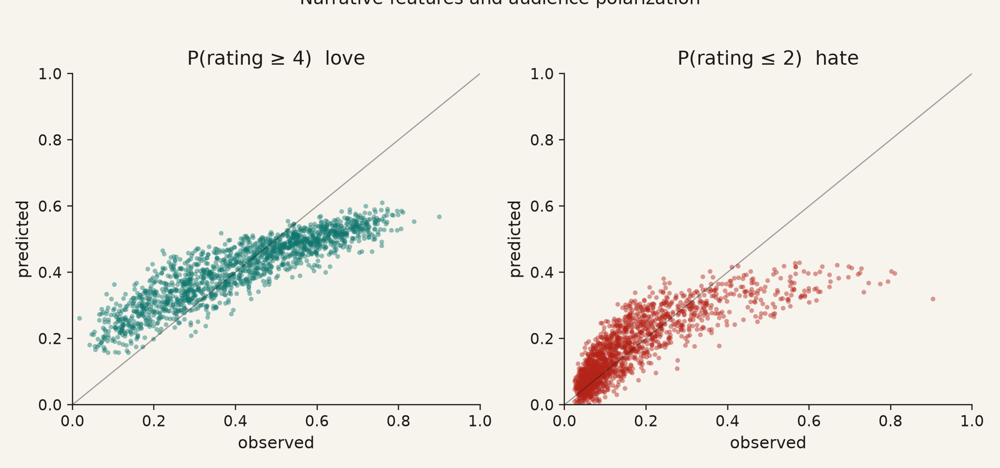
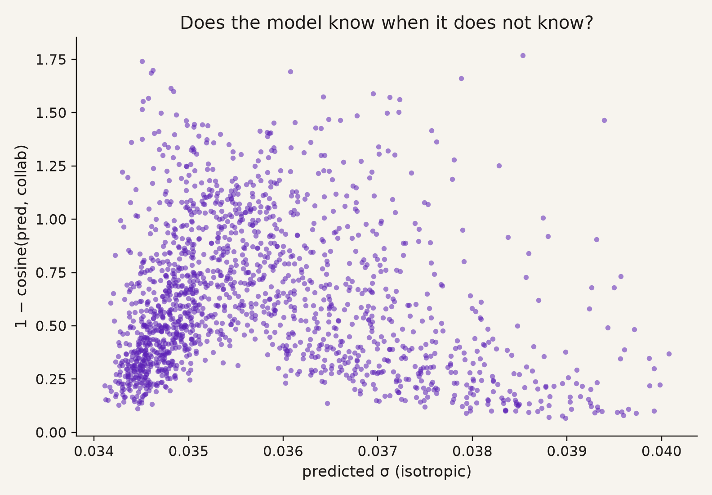
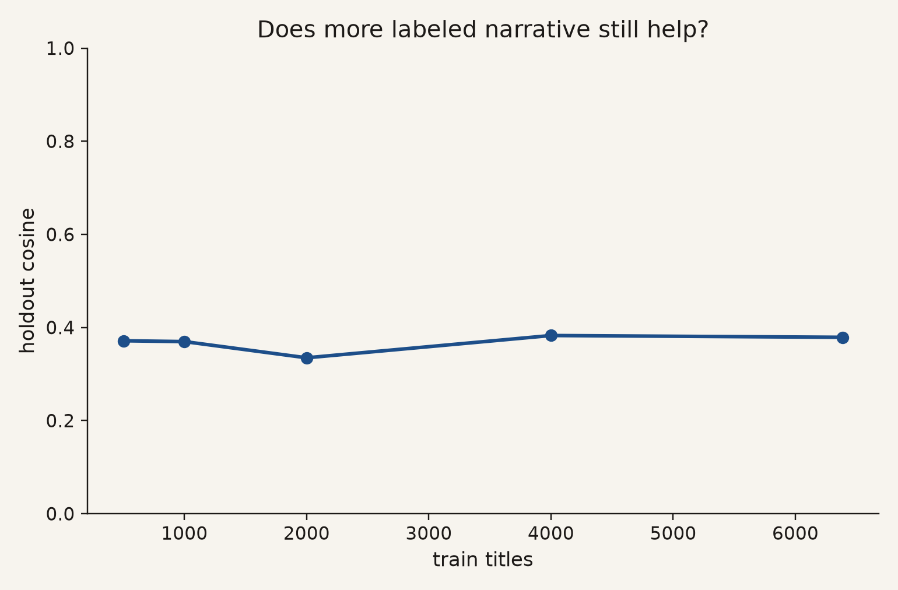
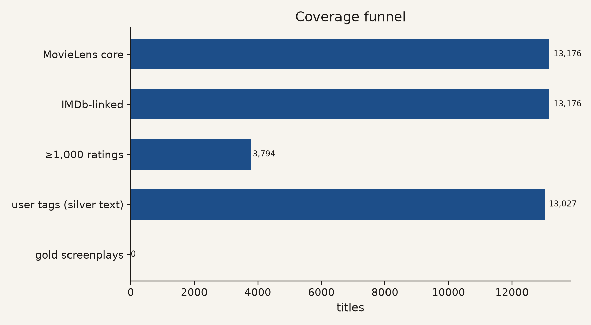

# From narrative to audience

A JAX/Equinox system that predicts **who a film is for** from story-shaped
information, before anyone has rated it.

The target is not box office. It is a point — with uncertainty — in the
64-dimensional audience space already learned from MovieLens ratings by the
sibling catalog-value project.

---

## Low — what this is, and why it is interesting

Imagine you are handed a script, or even just the way people *talk about* a
movie, and you have to guess **which kinds of viewers will love it**. Not how
much money it will make. Not whether critics will smile. *Who it is for.*

That is a different question from "is this good?" Two films can have the same
average rating and completely different crowds: a consensus crowd-pleaser, a
niche film that a small group adores, a polarizer that splits the room.

This project builds a map of movie taste from 25 million ratings, then asks a
new encoder, written in JAX, to land an unseen film on that map using only
content-like signals:

- genre and year (what a one-sheet already tells you)
- MovieLens "genome" tags (a rich but non-narrative content baseline)
- the words viewers themselves tag the film with (a silver stand-in for
  dialogue and cultural reception)
- a **set transformer** that treats those tags (and, later, screenplay scenes)
  as an unordered collection of story blocks

Until a gold corpus of several thousand genuine screenplays is licensed and
parsed, we do **not** claim "the screenplay predicts the audience." We claim
something more careful and already useful:

> Story-shaped information, encoded as a set of blocks with a probabilistic
> Equinox model, recovers a meaningful slice of the audience a film eventually
> finds — and it tells you when it is unsure.



The beige cloud is the collaborative audience map. Teal points are films the
model had to place **without using their ratings**. Bigger teal marks are more
uncertain guesses. That uncertainty is a feature: some stories really are
harder to place than others.



For a handful of famous films, the left column is "who actually showed up"
(nearest neighbors in rating space). The right column is "who the model
thought would show up" from content alone. When those lists rhyme, the
encoder has learned taste, not trivia.

---

## Medium — how the machine is put together

### Two repositories, one latent space

| Piece | Where it lives |
|-------|----------------|
| Who likes what (ratings only) | `catalog-value` Phase A |
| `z_i` collaborative fingerprint, 13,176 × 64 | `outputs/phase_a/titles.npz` |
| Genome MLP (PyTorch, the bar to beat) | `catalog-value` Phase B |
| Narrative / content encoders (Equinox) | **this repo** |
| Catalog value (MCV / PACV) | `catalog-value` Phases C–D, downstream |

The Equinox models emit the same 64-d vector plus a scalar variance, so a
predicted script can be dropped into the existing catalog-value posterior
without retraining the audience encoder.

### Modalities (ablations)

```text
metadata     genre + year
genome       1,128 tag relevances + genre + year     ← bar to beat
tags         hashed MovieLens user tags (bag)
hierarchical set transformer over the same tags as blocks
screenplay   parser ready; corpus not in git
```

Movie-level split: 20% of well-rated titles are held out entirely. The text
model never sees their collaborative embedding during training.

### Architecture, in one picture

```text
scene / tag / sentence
        │
   blake2b n-gram hash (256-d, frozen)
        │
   linear → GELU  (dialogue stream and action stream)
        │
   Induced Set Attention (learned inducing points)
        │
   Pooling by Multihead Attention (one movie query)
        │
   μ ∈ R⁶⁴ ,  log σ² ,  bias ,  polarization aux
        │
   residual:  μ_full = μ_dialogue + Δ(action, structure)
```

Training is Optax AdamW on a sum of embedding MSE, Gaussian NLL (so the
variance means something), bias MSE, and an auxiliary loss on
mean rating, rating std, P(r ≥ 4), and P(r ≤ 2).

### Results so far

| Modality | Train cosine | Holdout cosine | Holdout RMSE | Holdout NLL |
|----------|-------------:|---------------:|-------------:|------------:|
| metadata | 0.202 | 0.185 | 0.039 | -2.743 |
| genome | 0.387 | 0.379 | 0.035 | -2.863 |
| tags | 0.051 | 0.037 | 0.040 | -2.716 |
| hierarchical | 0.002 | 0.002 | 0.114 | -1.560 |


### What this run actually found

- **H1 holds for genome tags, not for hashed language.** Genome holdout cosine
  is 0.379 vs metadata 0.185.
  Content structure beats a one-sheet. Character-n-gram bags of user tags
  (0.037) and the set transformer over those bags
  (0.002) do **not** recover the 64-d fingerprint.
  The architecture is ready for real scene embeddings; hashing is not a
  substitute for a pretrained language encoder.
- **Polarization is the surprising win.** Genome Spearman with observed
  mean rating is 0.91, with P(love)
  0.91 and P(hate) 0.87.
  Even a moderate embedding cosine can still rank which films split a room.
- **H5 is not supported yet.** Spearman(error, σ) is
  -0.01 on genome holdout. The NLL term
  shrinks σ without making it track mistakes. Calibration needs a dedicated
  pass (temperature scaling or a proper heteroscedastic fit).
- **N_screenplay ∩ MovieLens is still 0.** The parser, provenance schema, and
  residual head are waiting on a gold corpus. Do not read tag results as
  screenplay results.




Read the teal bars: that is cold-start cosine. Genome should beat metadata.
Tags test whether *language* about a film carries audience signal beyond
structured tags. The set transformer tests whether treating language as a
**set of blocks** (the same inductive bias we want for scenes) helps.



Well-observed films are easier; the interesting points are the teal
cold-start titles. If cosine stays high there, content is doing real work.



Love and hate are not the same as the mean. A film can be a 3.5 that everyone
shrugs at, or a 3.5 that half the room worships.



Hypothesis H5: bigger predicted σ should line up with larger embedding error.
If that cloud slopes up, the model is calibrated enough to be useful in
development ("this script is genuinely ambiguous").



If the curve is still climbing at a few thousand titles, collecting more gold
screenplays is worth the cost. If it has flattened, architecture and
pretraining matter more than corpus size.



The binding constraint is the last bar. Everything else — IMDb ids, rating
depth, silver tags — is already in place.

### How to run

```bash
uv sync --dev
uv run pytest
uv run python -m audience_predictor coverage
uv run python -m audience_predictor train --modality genome
uv run python -m audience_predictor train --modality metadata
uv run python -m audience_predictor train --modality tags
uv run python -m audience_predictor train --modality hierarchical
uv run python -m audience_predictor evaluate
uv run python -m audience_predictor scaling
uv run python -m audience_predictor figures
uv run python -m audience_predictor report
```

Checkpoints live in `outputs/<modality>/`. Figures live in `reports/figures/`.

---

## High — model, protocol, and claims

### Target

Let `z_i` in R^64 be the catalog-value item embedding. Users are mixtures
`Z_u = {(pi_uk, z_uk)}` for k = 1..8. We do not retrain that space. We learn

```text
f(X_i)  →  N(μ_θ(X_i), σ_θ²(X_i) I)
```

and score cosine(μ_θ(X_i), z_i) on titles whose ratings were **never** used
to supervise the text model.

A Gaussian shrinkage posterior, identical in contract to catalog-value Phase B,

```text
w_i = n_i / (n_i + n0)
μ_i = w_i z_i + (1 - w_i) μ_θ(X_i)
```

keeps MCV plug-and-play. For true cold start, n_i = 0 and the posterior
collapses to the narrative prior.

### Set encoder

Blocks x_i1 … x_iT are hashed into R^d. An ISAB layer with m inducing
points compresses the set; PMA with a single learned query yields a movie
token. Dialogue and action are separate projections; structure (scene counts,
character entropy, graph density) is added into the residual stream:

```text
z_i = z_dialogue + Delta_i(action, structure)
```

This is the flagship scientific object. On silver data, "dialogue" is
folksonomy tags and "action" is empty, so Δ ≈ 0 and the identity is testable.
On gold screenplays, Δ is the incremental audience signal in description,
setting, and pacing — hypothesis **H2**.

Loss (per train movie):

```text
L = ||μ - z||² + λ_b (b - b_i)² + λ_n NLL(μ, σ²; z) + λ_a ||aux - y_pol||²
```

CRPS has a closed form for Gaussians and is reported on holdout for
calibration, not just accuracy.

### Protocol details

- Split unit: **movie**, not rating. `tests/test_splits.py` asserts disjoint
  index sets.
- Eligible train/holdout titles have ≥ 200 ratings.
- Holdout fraction: 0.2.
- Seed: 0. Embedding dim: 64.
- Hashing is blake2b modulo 256, character 3–5 grams,
  L2-normalized. Deterministic across processes (unlike `hash()`).
- JAX `vmap` + `eqx.filter_jit` over the full eligible train set. 13k titles
  is a small problem once features are precomputed; we do not re-tokenize.

### Hypotheses

| ID | Claim | Status in this milestone |
|----|-------|--------------------------|
| H1 | Content predicts audience beyond metadata | Testable: genome vs metadata holdout cosine |
| H2 | Full screenplay > dialogue | Structurally implemented; empirically pending gold scripts |
| H3 | Silver pretrain helps gold | Pending gold scripts |
| H4 | Multi-interest targets beat a single z | Target space is already multi-interest; not re-ablated here |
| H5 | σ tracks error | `uncertainty.png` / Spearman(error, σ) |
| H6 | Fingerprints feed catalog value | Interface-compatible; MCV transfer lives in catalog-value |

### Guardrails

- MovieLens users are not representative of moviegoers.
- Missing ratings are not dislikes.
- User tags leak *reception*, not pre-production text. They are an upper bound
  on "language about a film," not a substitute for a shooting script.
- A screenplay does not uniquely determine the finished film.
- This repo does not ship copyrighted screenplay text. The parser is tested on
  original fixtures.

### What "done" looks like for the gold-script era

Keep the Equinox encoder. Replace hashed tags with parsed scenes. Precompute
block embeddings once. Fine-tune. The residual head is already the experiment.
The coverage report is already the go/no-go dashboard
(`N_screenplay ∩ MovieLens`).

---

*Config: `default.yaml`. Embedding dim 64,
8 inducing points, 4 heads.*
